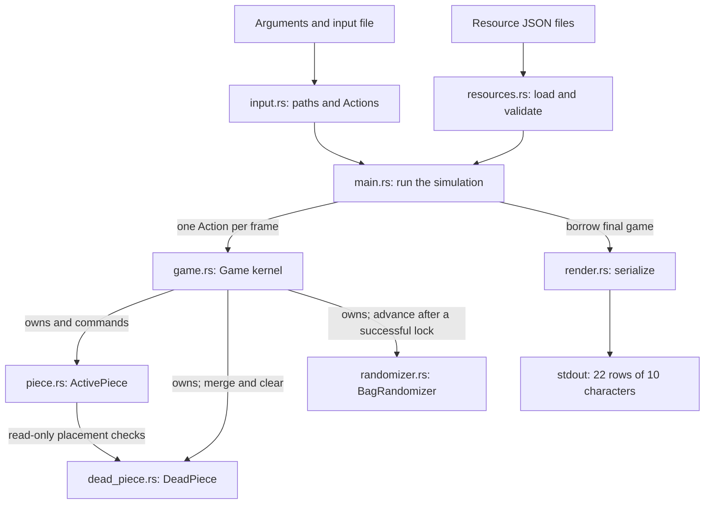
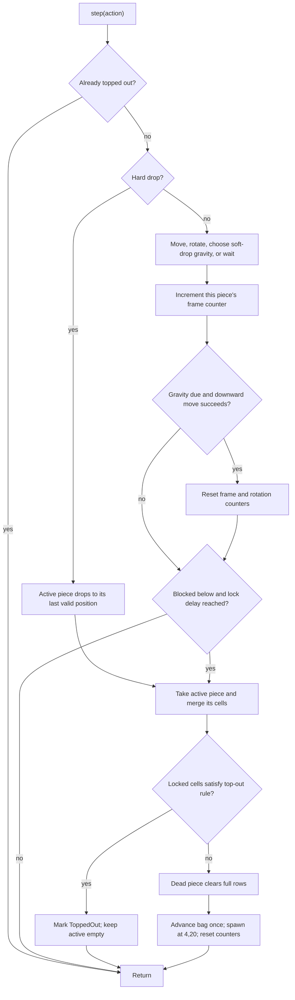
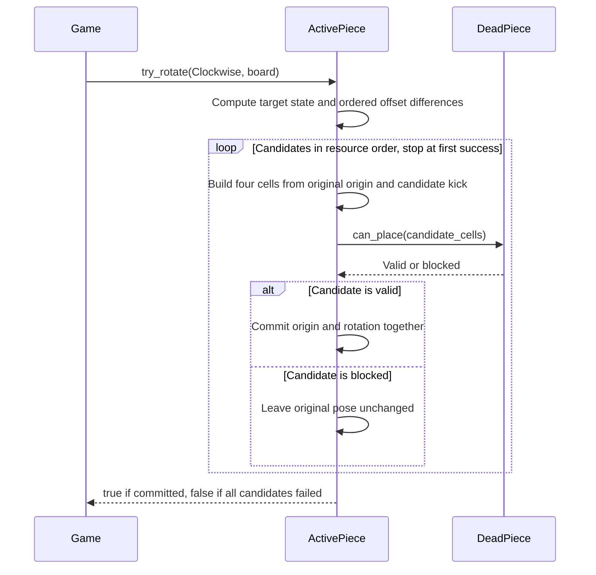

# Part 1: Tetris architecture

This design follows the six modules we discussed: input, terminal output, a small game kernel, a seven-bag randomizer, the falling piece, and the collection of locked cells. The only extra module is a resource loader for the JSON files.

The main idea is simple: **the kernel decides when; the piece and the board decide how.** The kernel advances one frame, asks the active piece to move or rotate, decides whether to lock it, and then asks the dead-piece module to merge cells and clear rows.

This document describes the Part 1 implementation. The Rust snippets summarize interfaces; the complete code is in `src/`. See [RUNNING.md](RUNNING.md) for commands and [tests/README.md](tests/README.md) for explanations of the tests.

## 1. Scope and requirements

The original proposal used the human-readable README through “Part 1 Implementation Advice.” Only two external pages were opened, both directly linked in that section: the SRS explanation and the top-out explanation. No internet searches were used. During implementation, the supplied resource JSON, single-player fixtures, and integration-testing instructions were also inspected. Their concrete values and expected results resolved the provisional locking and top-out rules; Section 10 records those corrections.

The reviewed README portion contained no HTML comments, hidden-content styling, invisible/control characters, or long opaque payloads indicative of hidden instructions. No suspicious malicious instructions were found in that portion. This is a report about the reviewed material, not an audit of the rest of the repository.

The program must:

| Requirement | Design consequence |
| --- | --- |
| Accept `--simulate-inputs-single-player <inputs-file>` and `--resources <directory>` | Parse the two paths before creating a game. |
| Interpret `C W L R D H E`, ignoring whitespace | Each action character produces exactly one frame. Whitespace produces no frames. |
| Simulate discrete frames | Call `Game::step(action)` in a loop. No real clock or sleeping is needed. |
| Load configuration, piece states, and wall-kick offsets from JSON | Load once at startup and pass typed data to the game. |
| Use the required deterministic seven-bag | Preserve the specified seed, versions, algorithm, ordering, and reshuffle procedure. |
| Apply actions before gravity and locking | Keep the frame sequence explicit in one short kernel method. |
| Check top-out before clearing lines | Use one shared lock-completion path for hard drops and timed locks. |
| Print a 10-column, 22-row board | Serialize the locked cells and current falling piece once at the end. |
| Stop advancing after top-out and show no next piece | Set `active = None`, mark the game finished, and stop consuming actions. |

“Render in the terminal” means writing the required plain text to stdout. Part 1 does not need keyboard polling, animation, a terminal UI library, or a 60 Hz timer. An empty input still has an initial falling piece to render. Reaching the end of a nonempty input leaves the current piece where it is; it does not force a final drop.

## 2. Module layout and ownership

Proposed files:

```text
src/
  main.rs         startup, action loop, final output, error reporting
  lib.rs          exposes the modules to main and the separate tests
  input.rs        command-line arguments and action parsing
  render.rs       exact board serialization
  game.rs         kernel: frame order, lock decisions, top-out, spawning
  randomizer.rs   the README's deterministic BagRandomizer
  piece.rs        active piece, shapes, rotations, candidate movement
  dead_piece.rs   locked cells, collision checks, merging, line clearing
  resources.rs    JSON loading and validation
```

These are ordinary Rust modules in one Cargo package, which builds the required `p5_tetris` binary. The small `lib.rs` lets separate integration tests call the same game code directly. There is no plugin system, event bus, or custom trait hierarchy.



`Game` owns the mutable state. The active piece borrows the dead piece while checking a move; it never changes locked cells. The renderer borrows the game and never changes anything. Modules communicate with direct method calls and return values.

| Owner | Data it owns | Why |
| --- | --- | --- |
| `Game` | Resources, randomizer, one `Option<ActivePiece>`, one `DeadPiece`, game status | There is one place to coordinate the simulation. |
| `ActivePiece` | Kind, shape/kick definition, origin, rotation, and per-piece counters | All state specific to the current falling piece stays together. |
| `DeadPiece` | A grid of occupied cells | After locking, original piece identities are irrelevant. |
| `Resources` | Config and the seven piece definitions | JSON is read once; gameplay does no file I/O. |
| `BagRandomizer` | Bag order, current index, seeded RNG | Randomness stays isolated and reproducible. |

At spawn, copy/clone the small definition for that piece into `ActivePiece`. This avoids lifetimes and shared ownership machinery. It is a few small arrays and lists per spawn, which is entirely reasonable here.

## 3. Coordinates and the board

Use the README's coordinate convention everywhere. The following numbers are the supplied defaults; the implementation reads width and height from config:

- `x` increases to the right, from `0` through `9`.
- `y` increases upward; `y = 0` is the floor row.
- The ordinary playfield is 20 rows high.
- The spawn origin is `(4, 20)`, with rotation `0`.
- A piece cell is `origin + shape_offset`.
- The output includes rows `21` down through `0`, in that order.

```text
               x = 0                 x = 9
                  +--------------------+
y = 21            | output / spawn area|  first printed row
y = 20            |     origin (4,20)  |
                  +--------------------+
y = 19            |                    |  top ordinary playfield row
                  |                    |
                  |                    |
y =  0            |                    |  last printed row
                  +--------------------+
                          floor
```

Keep coordinates signed while calculating candidates. A left move at `x = 0` or a downward move at the floor should fail a bounds check, not underflow an unsigned integer. Convert to array indices only after checking bounds.

Use a row-oriented representation for the dead piece:

```rust
pub struct DeadPiece {
    width: usize,
    height: usize,
    rows: Vec<Vec<bool>>, // rows[y][x], initially height + 2 empty rows
}
```

A vector of rows handles the configured width and height directly. It also lets a final locked piece retain cells above the output window without an out-of-bounds write. `merge` grows the vector only if necessary. The renderer prints `height + 2` rows, which is exactly 22 with the supplied config.

The proposed placement rule rejects side walls, the floor, and occupied cells. It treats positions above the stored rows as empty, rather than treating the output window as a ceiling. This allows a rotated piece near spawn to extend above row 21. The README does not explicitly define the upper collision boundary; this choice is recorded again in Section 10.

There is no separate board that stores both falling and locked cells. The dead piece stores locked cells; the falling piece is overlaid only when rendering. This avoids having to erase the old falling piece before every move.

## 4. Module interfaces

### 4.1 Input: turn text into actions

`input.rs` handles the external input format. It should not know anything about collision detection or gravity.

```rust
#[derive(Debug, Clone, Copy, PartialEq, Eq)]
pub enum Action {
    RotateClockwise,
    RotateCounterclockwise,
    Left,
    Right,
    SoftDrop,
    HardDrop,
    Wait,
}

pub struct CliOptions {
    pub inputs_path: PathBuf,
    pub resources_dir: PathBuf,
}

pub fn parse_args(args: impl Iterator<Item = OsString>)
    -> Result<CliOptions, Box<dyn std::error::Error>>;

pub fn parse_actions(bytes: &[u8])
    -> Result<Vec<Action>, Box<dyn std::error::Error>>;
```

Map `C W L R D H E` to the seven variants. Skip ASCII whitespace, including newlines, spaces, tabs, and carriage returns. Reject other bytes with a useful error, including their position. Do not silently turn invalid input into `Wait`.

A `Vec<Action>` is sufficient for Part 1. Loading and validating the file first does not advance the simulation. Once top-out occurs, the action loop stops consuming this vector. Behavior for malformed input after a would-be top-out is not specified; whole-file validation is a deliberate simple choice for invalid files.

Use a small argument parser from the standard library for these two flags. Accept either flag order; report missing values, duplicate flags, and unknown flags. `clap` is also allowed by the README, but this interface does not require it.

### 4.2 Resources: translate JSON into usable game data

`resources.rs` loads the supplied files from the requested directory and validates the resulting data before starting the game.

```rust
pub struct GameConfig {
    pub width: usize,
    pub height: usize,
    pub gravity: u32,
    pub gravity_decrease: u32,
    pub lock_delay: u32,
    pub random_seed: [u8; 16],
}

pub struct Resources {
    pub config: GameConfig,
    pieces: Vec<PieceDefinition>, // seven entries: I, J, L, O, S, T, Z
}

impl Resources {
    pub fn load(dir: &Path)
        -> Result<Self, Box<dyn std::error::Error>>;
    pub fn definition(&self, kind: PieceKind) -> &PieceDefinition;
}

impl GameConfig {
    pub fn gravity_for_frame(&self, soft_drop: bool) -> u32;
}
```

These field names match `resources/config.json`. The other files are `tetrominoes.json` and `wall_kicks.json`. Private `Deserialize` structs convert the shape arrays and named kick tables into `PieceDefinition` values. The unrelated `garbage_queue_time` field is ignored for Part 1.

Validation covers the seven required kinds, four rotations per kind, four distinct cells per shape, complete kick tables with matching candidate counts across rotations, valid seed data, and sensible numeric ranges. Array order in the kick lists is preserved. A malformed resource produces a short error and stops loading.

For soft drop, first compare `gravity_decrease` with `gravity`. If the reduction is at least the gravity interval, return zero; otherwise, subtract normally. With the supplied values this changes the interval from 20 to 10 frames, matching the soft-drop fixtures. An effective interval of zero makes the single gravity attempt immediately due; it does not cause an inner fall loop. A `D` action is not a direct one-cell translation and does not permanently modify the config.

Dependencies: `serde` with its derive feature, `serde_json`, and the two required RNG crates. The RNG crates are pinned exactly as the README specifies: `rand = "=0.10.3"` and `rand_xoshiro = "=0.8.1"`. `Cargo.lock` records the resolved dependencies.

### 4.3 Active piece: own the falling shape and its movement

`piece.rs` represents only the falling piece. It knows how to form candidate cells, test them against the dead piece, and commit a successful movement.

```rust
#[derive(Debug, Clone, Copy, PartialEq, Eq)]
pub struct Point {
    pub x: i32,
    pub y: i32,
}

#[derive(Debug, Clone, Copy, PartialEq, Eq)]
pub enum PieceKind { I, J, L, O, S, T, Z }

#[derive(Debug, Clone, Copy, PartialEq, Eq)]
pub enum Rotation { Spawn, Right, Half, Left }

#[derive(Debug, Clone, Copy)]
pub enum Turn { Clockwise, Counterclockwise }

#[derive(Clone)]
pub struct PieceDefinition {
    pub states: [[Point; 4]; 4],
    pub kick_offsets: [Vec<Point>; 4],
}

pub struct ActivePiece {
    kind: PieceKind,
    definition: PieceDefinition,
    origin: Point,
    rotation: Rotation,
    frames_since_fall: u32,
    rotations_since_descent: u32,
}

impl ActivePiece {
    pub fn spawn(kind: PieceKind, definition: PieceDefinition,
                 width: usize, height: usize) -> Self;
    pub fn kind(&self) -> PieceKind;
    pub fn cells(&self) -> [Point; 4];
    pub fn can_move_down(&self, board: &DeadPiece) -> bool;
    pub fn try_translate(&mut self, dx: i32, dy: i32,
                         board: &DeadPiece) -> bool;
    pub fn try_rotate(&mut self, turn: Turn, board: &DeadPiece) -> bool;
    pub fn hard_drop(&mut self, board: &DeadPiece) -> u32;
    pub fn advance_clock(&mut self);
    pub fn frames_since_fall(&self) -> u32;
    pub fn rotations_since_descent(&self) -> u32;
    pub fn record_fall(&mut self);
}
```

`spawn` sets the origin to `((width - 1) / 2, height)`, normally `(4, 20)`, rotation to `Spawn`, and both counters to zero. `cells` returns the four absolute cell positions from the current state; it does not cache another copy of the board. `can_move_down` checks the next row without changing the piece, letting the kernel decide whether it is grounded.

`try_translate` calculates a proposed origin, gets its four cells, and calls `board.can_place`. It changes the origin only if the entire candidate is valid. A blocked translation returns `false` and leaves the piece unchanged.

`try_rotate` advances the rotation index modulo four, obtains the old/new offset lists, and tries the resulting kicks in order. It commits the new rotation and origin together on the first success. If all candidates fail, neither changes. Section 6 shows the algorithm.

`hard_drop` repeatedly tries `(0, -1)` until it fails and returns the distance moved. A straightforward loop is sufficient for this small board. It does not merge cells, clear lines, choose a new piece, or end the game. Those are kernel decisions.

`advance_clock` increments the frame counter once with `+= 1`. `record_fall` resets that counter and the rotation counter after an actual gravity descent, including a descent accelerated by `D`. The kernel calls these methods; movement geometry does not independently change the clock.

The README lists a rotation counter but does not specify a rotation limit or timer reset rule that uses it. Provisionally, increment `rotations_since_descent` on a successful rotation and reset it on a downward gravity move or spawn. Do not invent an extra lock-reset mechanic from this field. Its exact bookkeeping can be adjusted if clarified without changing movement or locking architecture.

### 4.4 Dead piece: one collection of locked cells

`dead_piece.rs` implements the user's “one giant dead piece” idea directly. It stores occupancy, not a list of old `ActivePiece` objects.

```rust
impl DeadPiece {
    pub fn new(width: usize, height: usize) -> Self;
    pub fn width(&self) -> usize;
    pub fn height(&self) -> usize;
    pub fn occupied(&self, x: usize, y: usize) -> bool;
    pub fn can_place(&self, cells: &[Point; 4]) -> bool;
    pub fn merge(&mut self, cells: &[Point; 4]);
    pub fn clear_full_rows(&mut self) -> usize;
}
```

`can_place` is the shared collision rule used by translations, rotations, and drops:

1. Every cell must have `0 <= x < width`.
2. Every cell must have `y >= 0`.
3. Every cell must be unoccupied in the locked grid. Rows above the stored grid are empty under the proposed upper-boundary rule.

`occupied` expects a valid column and returns `false` for rows beyond stored data. It is useful for both collision checking and rendering.

`merge` sets the four locked cells to occupied, growing the row vector if necessary. It does not clear lines automatically and does not decide whether the game is over. Separating merge from clear is necessary because top-out is checked between them.

`clear_full_rows` removes all full rows in one bottom-to-top compaction pass and returns the number removed. Preserve each surviving row's contents and relative order. Clear the unused rows at the top afterward. Section 7 gives the exact approach.

### 4.5 Randomizer: preserve the staff sequence

Use the `BagRandomizer<T>` design provided in the README, instantiated with `PieceKind`.

```rust
pub struct BagRandomizer<T> {
    bag: Vec<T>,
    idx: usize,
    rng: Xoshiro128PlusPlus,
}

impl<T> BagRandomizer<T> {
    pub fn from_parts(bag: impl Iterator<Item = T>, seed: [u8; 16]) -> Self;
    pub fn cur(&self) -> &T;
    pub fn next(&mut self);
}
```

Initialize with the exact order `I, J, L, O, S, T, Z`. Seed `Xoshiro128PlusPlus` with the configured seed and shuffle immediately, as in the README. On exhaustion, reshuffle the existing bag in its current order. Rebuilding it in canonical order before each shuffle changes the deterministic sequence.

Use one convention consistently: **`cur()` is the active piece's kind.** At initialization, spawn `cur()` without advancing. After a lock that does not end the game, call `next()` once and spawn the new `cur()`. Do not advance for failed moves, rotations, rendering, or top-out.

No custom randomizer trait is needed. The implementation uses the RNG crate's `SeedableRng` and slice-shuffling extension traits, matching the required versions and the README example.

### 4.6 Kernel: own the game and sequence the work

`game.rs` should read like the per-frame instructions in the README.

```rust
#[derive(Debug, Clone, Copy, PartialEq, Eq)]
pub enum GameStatus { Running, ToppedOut }

pub struct Game {
    resources: Resources,
    bag: BagRandomizer<PieceKind>,
    active: Option<ActivePiece>,
    dead: DeadPiece,
    status: GameStatus,
}

impl Game {
    pub fn new(resources: Resources) -> Self;
    pub fn step(&mut self, action: Action);
    pub fn is_over(&self) -> bool;
    pub fn active(&self) -> Option<&ActivePiece>;
    pub fn dead(&self) -> &DeadPiece;

    fn finish_lock(&mut self);
    fn spawn_current(&mut self);
    fn lock_due(&self) -> bool;
}
```

`Game::new` creates an empty dead piece and the seeded bag, then spawns its current piece. At public method boundaries, a running game has an active piece; a topped-out game has none.

`step` routes an action and handles the timing decisions. It does not contain a wall-kick loop, a hard-drop loop, cell-by-cell collision logic, or row-compaction logic.

For `C` and `W`, the kernel asks `try_rotate` to handle the rotation, including any needed kick. It does not first duplicate the piece's overlap calculation. This is a small refinement of “the kernel decides when a wall trick is required”: the kernel decides when a rotation attempt happens, while the piece determines which geometric candidate works.

`finish_lock` is the only place where an active piece becomes locked cells. Using `Option::take` makes that transition explicit and avoids accidentally rendering the old active piece after it has been merged.

`lock_due` is a small private predicate: the piece must be unable to move down and its counter must have reached the lock delay. `finish_lock` checks whether any newly locked cell has `y >= height`. These rules are local to the kernel.

### 4.7 Renderer: exact output, no game logic

```rust
pub fn serialize(game: &Game) -> String;
```

No renderer struct is necessary because the renderer owns no persistent state.

Start with a 22-by-10 temporary character grid. Copy the dead-piece occupancy into it, then overlay `game.active().cells()` if an active piece exists. Ignore active or locked cells outside the output's vertical window when drawing; this does not remove them from simulation state. Emit rows from `y = 21` down to `y = 0`, using only `o`, `.`, and newlines.

Return exactly 22 lines of 10 characters, each followed by a newline. `main` writes that string without adding another newline. No borders, labels, scores, ANSI colors, or intermediate frames belong on stdout. Report errors on stderr with a nonzero exit status.

### 4.8 Traits: only the ones that help

There are no custom traits in this design. Each module has one implementation, so concrete types make the relationships easier to follow.

| Area | Useful standard/library traits |
| --- | --- |
| `Action`, `Point`, `PieceKind`, `Rotation`, status | `Debug`, `Clone`, `Copy`, `PartialEq`, `Eq` for small values and assertions. |
| Piece definitions | `Clone` to give each spawned piece its small definition. |
| JSON wire types | `serde::Deserialize`; map them to internal types if names or layout differ. |
| Randomizer | `SeedableRng` and the required version's slice-shuffling trait. |
| CLI boundary | `std::error::Error`; `std::io::Write` for output. |

For a program this size, `Box<dyn Error>` at the file/CLI boundary is enough. Add a specific error enum only if handling different error kinds becomes useful. Game actions themselves are not errors: an obstructed move simply returns `false`.

## 5. One frame, step by step

The update cycle is driven by the input file. One parsed action means one call to `step`.



In pseudocode:

```text
step(action):
    if game is over: return

    if action is H:
        active.hard_drop(dead)
        finish_lock()
        return

    C / W: active.try_rotate(direction, dead)
    L / R: active.try_translate(horizontal_delta, 0, dead)
    D / E: no direct geometric action

    gravity = config.gravity_for_frame(action is D)
    active.advance_clock()

    if active.frames_since_fall >= gravity:
        if active.try_translate(0, -1, dead):
            active.record_fall()

    if lock_due():
        finish_lock()
```

There is at most one gravity descent per ordinary frame, even if the counter has exceeded the interval. A failed gravity move does not reset the counter. A failed input move still consumes its frame, so the clock and gravity checks still happen.

`lock_due` requires both `!active.can_move_down(dead)` and `frames_since_fall >= config.lock_delay`, after the gravity attempt and any successful-fall reset. The supplied config has gravity 20 and lock delay 15; the expected outputs show the first piece still falling at frame 20. This rules out the original proposal's unconditional timer check, which would have locked the piece in midair at frame 15.

Hard drop locks immediately. Its branch returns after lock completion so that a newly spawned piece receives neither a clock increment nor gravity in the old piece's frame. Timed locking uses the same completion routine:

```text
finish_lock():
    piece = take active piece
    cells = piece.cells()
    dead.merge(cells)

    if any locked cell has y >= config.height:
        status = ToppedOut
        return

    dead.clear_full_rows()
    bag.next()
    spawn_current()
```

Checking for line clears only after a lock is sufficient: moving a falling piece does not change locked occupancy, and the previous successful lock already removed all full rows. A loss freezes the merged board before line clearing. The piece that caused the loss remains visible where it intersects the 22-row output window, but no successor is drawn.

## 6. Rotation and wall-kick data flow

Use the shape states and offset data supplied in resources. Do not derive rotated cells with a general rotation matrix or replace the resource tables with remembered Tetris rules.

For a rotation from state `a` to state `b`, candidate `i` uses:

```text
kick[i]       = offsets[a][i] - offsets[b][i]
new_origin    = old_origin + kick[i]
candidate[j]  = new_origin + states[b][j]     for j = 0..3
```

Every candidate starts from the original origin. Do not accumulate failed kicks.



For the README's Normal `0 -> R` example, the ordered candidates are `(0,0)`, `(-1,0)`, `(-1,1)`, `(0,-2)`, `(-1,-2)`. The first valid one wins.

Do not test an extra unshifted rotation before the table. The first offset-derived candidate is already the first permitted test, and it need not be `(0,0)` for every piece. In particular, the linked SRS explanation describes how I/O origin conventions can require a correction even for the first candidate. The resource table should drive this behavior, including the O piece. [SRS offset explanation](https://tetris.wiki/Super_Rotation_System#How_Guideline_SRS_Really_Works).

## 7. Clearing several rows correctly

Use two row indices, `read` and `write`, both starting at the bottom:

```text
write = 0
cleared = 0

for read from 0 to rows.len - 1:
    if rows[read] is full:
        cleared += 1
    else:
        rows[write] = rows[read]
        write += 1

fill rows[write..] with empty rows
return cleared
```

Because `write <= read`, copying a surviving row downward does not overwrite an unread row. This handles adjacent and separated full rows in the same pass.

For example, suppose only these bottom five rows contain cells:

```text
Before, printed top to bottom       After clearing rows 1 and 3

y=4   ..oo......  survives          y=4   ..........
y=3   oooooooooo  removed           y=3   ..........
y=2   o.........  survives          y=2   ..oo......  old row 4
y=1   oooooooooo  removed           y=1   o.........  old row 2
y=0   .o........  survives          y=0   .o........  old row 0
```

This is a row operation. Cells within a surviving row do not fall independently, and the original tetromino identities do not matter.

## 8. End-to-end execution

`main.rs` is only the composition point:

```text
parse command-line arguments
load and validate Resources
read input file and parse Actions
create Game, including the first spawned piece

for action in Actions:
    if game.is_over(): break
    game.step(action)

write render::serialize(game) to stdout
```

For the example input `CCLEEEH`, the parser returns seven actions. The kernel requests two clockwise rotations, a left translation, and three wait frames, then a hard drop. All six ordinary frames still perform their timing/gravity work. The final `H` drops and locks the current piece; if that does not top out, the next piece is spawned before rendering. Whitespace around those letters changes nothing.

The data transformations are:

```text
file bytes
   -> Action values
   -> kernel decisions
   -> proposed piece cells
   -> collision checks against locked cells
   -> committed active pose
   -> locked occupancy when the kernel calls finish_lock
   -> compacted rows if the game continues
   -> locked occupancy + active cells
   -> exactly 22 text lines
```

## 9. Implementation order and useful checks

Build in small steps so the complete input-to-output path works early.

| Step | Implement | Check before moving on |
| --- | --- | --- |
| 1 | Input parsing, resource loading, basic types | All seven controls map to the correct actions; whitespace adds no frames; the supplied resources load successfully. |
| 2 | Empty dead piece, initial bag, spawning, serialization | Empty input renders the first piece at `(4,20)` with 22 rows of 10 characters. |
| 3 | Collision checks and translations | Walls, floor, and locked cells block movement; blocked movement leaves the pose unchanged. |
| 4 | Hard drop, merge, shared lock completion | A hard drop reaches the last valid position, locks once, and spawns exactly one successor unless topped out. |
| 5 | Row compaction | One, adjacent, and separated full rows clear correctly; surviving row order is preserved. |
| 6 | Rotations and kicks | Clockwise/counterclockwise transitions, a later kick succeeding, all candidates failing, and I/O table handling. |
| 7 | Frame counter, gravity, soft drop, timed locking | Exact `>=` boundaries, one gravity step per frame, failed-fall behavior, and no extra tick on a new piece. |
| 8 | Top-out boundaries and supplied integration checks | Loss happens before a possible clear; trailing actions do nothing; no successor appears. |

Keep the tests focused on correct gameplay with valid inputs:

- **Input:** all seven controls parse correctly, and whitespace does not change the action sequence.
- **Timing:** gravity and grounded locking happen on their exact frames; the new piece starts with a fresh timer.
- **Soft drop:** the supplied interval becomes 10, while reductions reaching or exceeding the interval give zero and still cause only one descent per frame.
- **Rotation:** try kicks in order, leave a fully blocked rotation unchanged, and apply the special I and O tables correctly.
- **Row clearing:** remove adjacent or separated full rows while preserving the contents and order of surviving rows.
- **Top-out:** check loss before clearing a row, spawn no successor, and ignore later actions.
- **Complete games:** run the supplied cases to check movement, drops, seeded spawning, clearing, and the exact final board output together.

`cargo test` runs eight focused tests in `tests/gameplay.rs` and one test in `tests/cli.rs`. The latter runs all 12 supplied single-player input files and compares stdout exactly with their `.expect` files, without requiring an extra test runner. [tests/README.md](tests/README.md) explains every test. A board is tiny, so ordinary vectors, short loops, and direct comparisons are sufficient.

## 10. Implementation decisions and remaining gaps

The initial proposal flagged several ambiguities. The supplied config and fixtures now settle the two most consequential ones. The table records the implemented behavior and where it comes from.

| Question | What the README says | Implemented behavior and evidence |
| --- | --- | --- |
| Is locking at `y = 20` a loss? | Coordinates are zero-indexed, the board has 20 ordinary rows, and loss is described as any cell “above row 20.” | Yes: `y >= config.height` ends the game. The supplied `topped-out` fixture ends with locked cells in row 20, no cells in row 21, and no successor. The dedicated small-board test also checks the exact boundary before line clearing. |
| Must a piece be blocked below before timed locking? | The frame sequence compares the counter to lock delay without an explicit grounded condition. | Yes. Default gravity is 20 and lock delay is 15, while the supplied fixtures require an airborne piece to survive until its first descent. `Game::lock_due` checks both blocked movement and the counter. |
| When does a successful fall reset the clock? | The state is described as frames since a forced downward move; resetting on lock is also mentioned explicitly. | Reset on each successful gravity descent and each spawn. Failed gravity, lateral movement, and rotation do not reset it. This follows the counter's meaning, though every reset is not separately enumerated. |
| How is the rotation counter used? | It is listed as state, but no threshold or effect is given. | Track successful rotations since the last gravity descent provisionally; do not make it affect locking without a specified rule. |
| What happens above row 21? | Output is 22 rows, but no complete upper collision rule is provided. | Allow active cells above the output window and retain merged cells if needed. Reject only side/floor bounds and occupancy in `can_place`; crop only during serialization. |
| What exactly does the soft-drop config value mean? | Soft drop temporarily decreases gravity by a configured value. | Return zero if `gravity_decrease >= gravity`; otherwise, subtract the reduction for the current frame. Attempt at most one descent. The supplied `soft-drop`, `last-minute-soft-drop`, and `start-soft-drop-but-stop` fixtures all match. |

The top-out link explains partial lock-out in terms of a locked piece extending out of bounds, including when it would clear a line. It supports checking loss before clearing. The assignment fixture supplies the numeric-boundary evidence above. [Top-out definitions](https://tetris.wiki/Top_out#Loss_condition).

There is no separate spawn-overlap loss rule in this implementation. With loss at `y >= height`, a continuing game has no locked cells in the spawn rows. The original proposal's concern about leaving occupancy in row 20 therefore no longer applies.

The illustrative J JSON in the README contains repeated coordinates in some states and has a trailing comma. Treat it as an illustration of the layout, not the source of shape data. Load the actual supplied resource definitions during implementation and report malformed data rather than quietly repairing it. This appears to be an example-quality issue, not a hidden instruction.

## 11. Sources and status

- [Assignment README: Part 1](README.md#part-1-single-player-tetris), including its input, output, randomizer, frame sequence, rotations, drops, and implementation advice.
- [SRS offset explanation](https://tetris.wiki/Super_Rotation_System#How_Guideline_SRS_Really_Works), followed directly from the README for rotation context.
- [Top-out definitions](https://tetris.wiki/Top_out#Loss_condition), followed directly from the README for loss terminology.

Part 1 is implemented in `src/`, with dependencies in `Cargo.toml`, focused tests in `tests/`, and a walkthrough in `RUNNING.md`. The supplied README, resource files, and CLI fixtures remain unchanged. Parts 2 and 3 are outside this implementation.
